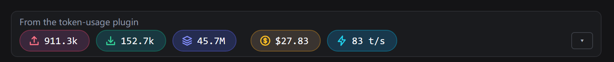
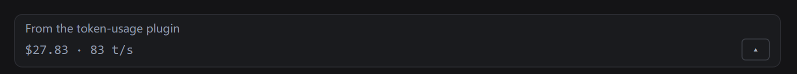
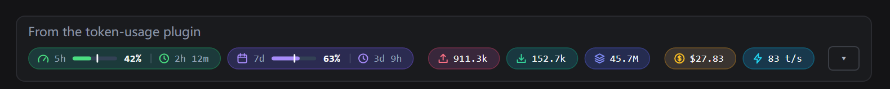

# token-usage（输入框上方的用量条）

Claude Code 的 mod：在输入框上方显示当前会话的 token 用量、估算费用和输出速度。

本仓库 fork 自 [letswritetw/claude-mod-token-usage](https://github.com/letswritetw/claude-mod-token-usage)。原仓库没有声明许可证，本 fork 仅做个人使用和改进，未取得额外授权前请勿再分发。

## 效果

展开：



收起（占一行，只留费用和速度）：



订阅账号会多出 5h / 7d 额度两个胶囊：



> 图片由 mod 里真实的绘制函数生成，再用浏览器渲染，不是 VS Code 里的截图。「From the token-usage plugin」这一行是 Claude Code 客户端自己加的，用来标明这块界面由哪个插件绘制，mod 去不掉。

## 各个胶囊的含义

| 胶囊 | 含义 |
|---|---|
| ↑ 红色 | 输入 token（含缓存写入） |
| ↓ 绿色 | 输出 token |
| 叠层 蓝紫色 | 缓存读取 token，计费比普通输入低 |
| $ 橙色 | 本会话费用，按 API 标价估算 |
| ⚡ 青色 `83 t/s` | 输出速度，每秒 token 数 |
| 5h / 7d | 订阅额度和重置倒计时，仅订阅账号有数据 |
| 最右侧箭头 | 点击收起 / 展开 |

## 相比原版的改动

- 新增输出速度 `t/s`：从流式回复的第一块数据开始计时，到结束为止，用输出 token 数除以这段时间，不含等待首字的时间。
  - 只统计主代理，不统计子代理。
  - 输出少于 50 个 token 或生成时间不到 250 毫秒的请求不计入，避免短回复把数字拉得很夸张。
- 新增收起 / 展开：右侧一个暗色小箭头，收起后只剩一行 `费用 · 速度`，状态会被记住。
- 按会话记住累计数据：关闭再打开、恢复同一个会话时接着累加，不会清零。
- 界面文字从繁体改成简体。
- 修了类型错误：终端降级显示里的进度条类型写得过窄，`tsc` 会报错。

## 安装

要求：Claude Code 2.1.287 或更高，并支持 mod 功能。作者在 Windows 上的 VS Code 扩展 2.1.326 里测试过。

推荐手动安装，只改两处，其他配置都不动：

1. 把本仓库的 `token-usage` 文件夹复制到 `~/.claude/mods/token-usage`（Windows 是 `C:\Users\你的用户名\.claude\mods\token-usage`）。
2. 先备份 `~/.claude/settings.json`，再在它的 `env` 里加这两项：

   ```json
   "CLAUDE_CODE_PLUGIN_DIRS": "C:/Users/你的用户名/.claude/mods/token-usage",
   "CLAUDE_CODE_PLUGIN_DIR_WATCH": "1"
   ```

3. 完全关闭并重新打开 VS Code（或 Claude Desktop）。

仓库里原作者的 `install.ps1`、`install.sh` 也能用，但 PowerShell 脚本会用 `ConvertTo-Json` 整体重写 `settings.json`，配置多的话建议先备份，或直接手动安装。

## 卸载

删除 `~/.claude/mods/token-usage`，并从 `settings.json` 的 `env` 里去掉上面两项。

## 已知限制

- VS Code 扩展里这条横条是以图片方式绘制的，悬停提示和手型光标不生效。代码里仍保留了悬停提示和悬停变色，在支持的客户端里可能有效，我没有测试过。
- 展开 / 收起按钮是客户端自带的按钮样式，只能选默认和暗色两种，所以带一圈细边框。
- 速度是估算值。如果你走的是 API 网关，且网关把流缓冲后一次性输出，算出的速度会偏高。
- 累计数据按会话保存；收起状态是全局的，所有会话共用。
- 5h / 7d 额度需要订阅账号，用自己的 API 地址时这两个胶囊不会出现。
- 重启后速度的“最近一次”数值会保留，但要等下一次足够长的回复才会更新。

## 安全说明

整个 mod 只有 `hooks/register.tsx` 一个文件，没有依赖。我读过全部代码：只订阅会话事件、做加法、画图；没有联网、读写文件、执行命令的调用，也不读 `settings.json` 里的密钥。持久化只用 Claude Code 提供的 `$.store`。这是读代码得出的判断，不是杀毒引擎的结论。

## 开发

Claude Code 首次加载 mod 时，会在 `.claude-plugin/types/` 下生成类型定义和 `tsconfig.json`，可以直接做类型检查：

```bash
cd ~/.claude/mods/token-usage
npx -p typescript tsc -p .claude-plugin/types/tsconfig.json --noEmit
```

开着 `CLAUDE_CODE_PLUGIN_DIR_WATCH` 时，改完文件会热重载。加载器对 `$` 有静态限制：`$` 只能传给文件顶层声明的函数，所以 `restore`、`save`、`loadFold` 都写在文件顶层。
